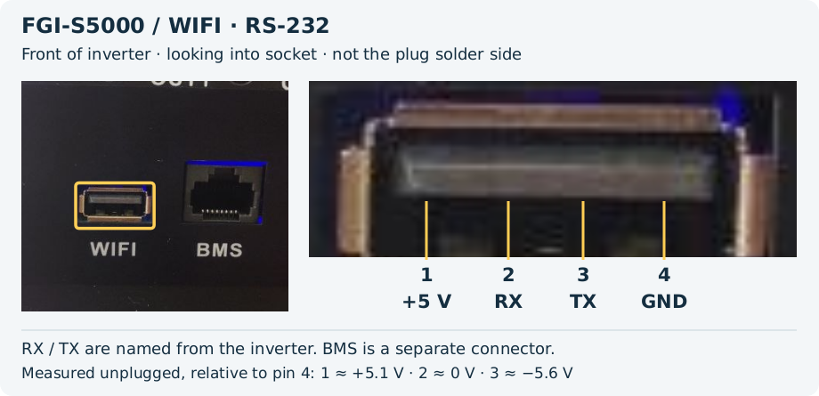
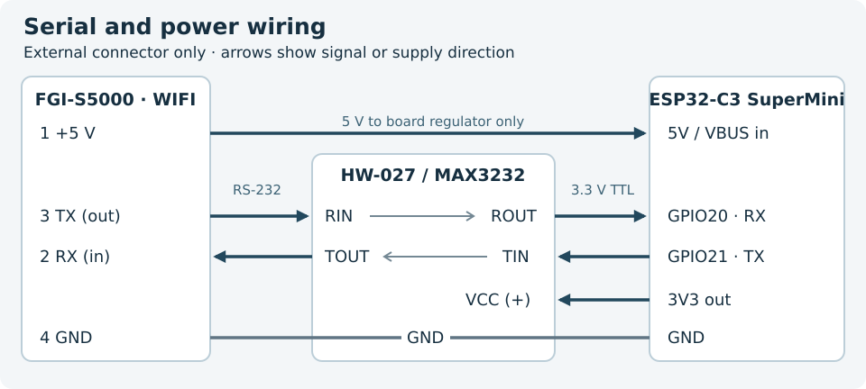
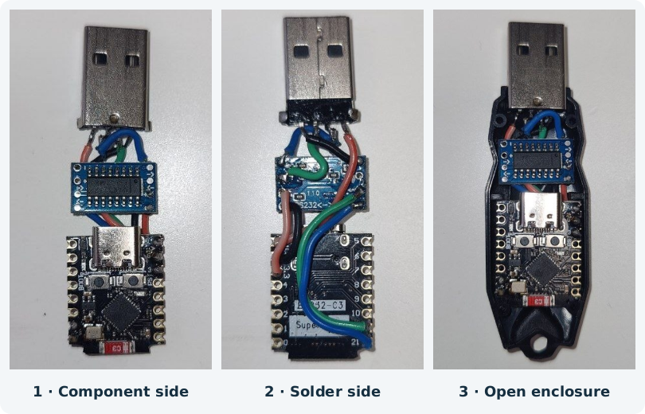

# Anern FGI-S5000: build an RS-232 collector for Home Assistant

[Українською](README.uk.md) · [All examples](../README.md)

This 24 V FGI-S5000 (single-phase 5KU) had no factory Wi-Fi logger. A 4 MB ESP32-C3 SuperMini and a HW-027/MAX3232 plugged into its external **WIFI** socket let EyeBond Local automatically identify the inverter, read its measurements and change settings. The ESP handles the serial link; the register map is in Home Assistant, not in the collector firmware.

## 1. Identify the socket before soldering

[Original panel photo](images/inverter-port.jpg). Look **into the inverter**, with the WIFI lettering upright and the BMS jack on the right. The Type-A shell is used for **RS-232, not USB data**. The manual calls this the optional stick's COM port; its adjacent pinout table is for **BMS**, not WIFI. Do not plug a computer or a standard USB peripheral into WIFI.

| Left → right, as photographed | Signal at the inverter | Measured with no collector, relative to pin 4 |
|---|---|---|
| 1 | +5 V supply out | +5.1 V |
| 2 | RX: receives from the collector | About 0 V; an undriven input |
| 3 | TX: sends to the collector | About −5.6 V at idle |
| 4 | Signal ground | Reference |

These are readings on this unit, not a manufacturer pinout for all Anern products. With the converter connected both data pins can idle negative: the converter now drives pin 2 as well. A DC reading alone does not demonstrate traffic. Before applying power, use continuity on the **disconnected plug** to identify its solder pads; the rear or opposite mating view may be mirrored. Do not identify contacts by wire colour or use the shell as a substitute for pin 4.

## 2. Wire the collector

Parts: 4 MB ESP32-C3 SuperMini with USB-C and an active-low LED on GPIO8, a 3.3 V-compatible MAX3232 RS-232↔TTL module (HW-027 in the photos), Type-A male plug with four contacts, short insulated wires and an insulating enclosure. Do not work inside the inverter. Disconnect the assembly before soldering; keep its Type-A plug **out of the inverter** whenever powering or flashing the ESP from a computer.

| Path | Connection on this build |
|---|---|
| Power | Pin 1 → ESP **5V** input. ESP **3V3** output → converter **+ / VCC**. Do not connect pin 1 to ESP 3V3 or power the converter logic from pin 1. |
| Ground | Pin 4 → ESP GND and converter **− / GND**. |
| Inverter → ESP | Pin 3 (TX) → converter RS-232 **RIN** → TTL **ROUT** → ESP **GPIO20 (RX)**. |
| ESP → inverter | ESP **GPIO21 (TX)** → converter TTL **TIN** → RS-232 **TOUT** → pin 2 (RX). |

RIN/ROUT and TIN/TOUT are the receiver and transmitter paths, not necessarily labels printed on the module. On arrow-marked boards follow the signal **into or out of the converter**, and identify the TTL and RS-232 sides first. Never connect the negative-voltage RS-232 lines directly to ESP GPIO. No RS485 DE/RE wire or external LED is required.

Full-size photos: [1 · Components](images/collector-front.jpg) · [2 · Soldering and GPIO20/21](images/collector-back.jpg) · [3 · Enclosure](images/collector-case.jpg).

## 3. Flash and connect

1. Use [**esp32-c3.yaml**](../../../examples/esp32-c3.yaml). This is the public configuration for the board and wiring used here; Wi-Fi credentials, a private endpoint and the unit's identity are not baked in. Do not use the classic ESP32 DevKit image.
2. With the inverter plug disconnected, connect a USB **data** cable to the board's USB-C. In a release listing **ESP32-C3 SuperMini (4 MB)**, choose it in the [web installer](https://groove-max.github.io/esp-eybond-collector/), or use its merged `esp32-c3.factory.bin` at offset 0 for a first USB flash. For a local preview/build, see [release instructions](../../RELEASING.md). This image is **not** an OTA image.
3. Join the collector's setup AP (normally its synthetic PN beginning with V), open `http://192.168.4.1/` and select your 2.4 GHz Wi-Fi. Use a trusted network; do not expose the configuration or OTA services to the internet. For a private ESPHome build, the dashboard imports the same C3 YAML; see the [first-setup guide](../../FLASHING.md).
4. Disconnect USB-C; insert the collector into **WIFI**. Use **9600 baud, 8 data bits, no parity, 1 stop bit**. The inverter speaks **Modbus RTU, slave 1**. USB logging is separate from the inverter UART.
5. In [EyeBond Local](https://github.com/groove-max/ha-eybond-local), use a build with the `fgi_5ku` map, add the collector and leave inverter detection on **Auto**. Across routed networks, local broadcast discovery need not work: enter a reachable HA listener address and its configured TCP port on the collector's setup page. The **ESP initiates** the connection. Prefer a private route/VPN; do not forward the collector's web UI. An HA collector connection alone does not prove the RS-232 link is working.

## 4. Confirm a real reading

On the mains-only bench HA identified the 5KU family without a map override and reported **232.8 V, 49.99 Hz and 0 W** with no output load. Compare a fresh voltage reading with the LCD. If the collector is online but the inverter is missing, check the preset, UART format, level-converter supply and both directed signal paths before changing the software. If even the collector is missing, check Wi-Fi and the callback destination first.

All 20 selected polling blocks responded. Of 74 HA controls, 43 had a changed value independently read back and restored; 31 are documented but not verified by such a test. No battery, PV or load was connected: these results do not validate charging, export or every setting. This test used an HA development build with the FGI map. If your installed integration lacks that map, changing the collector firmware alone will not add it.
