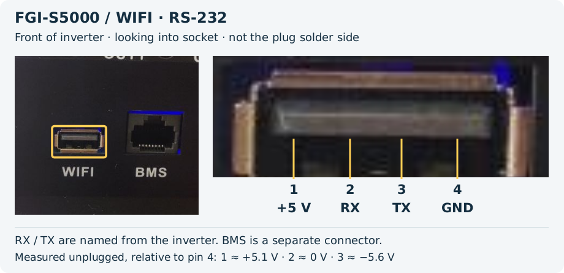
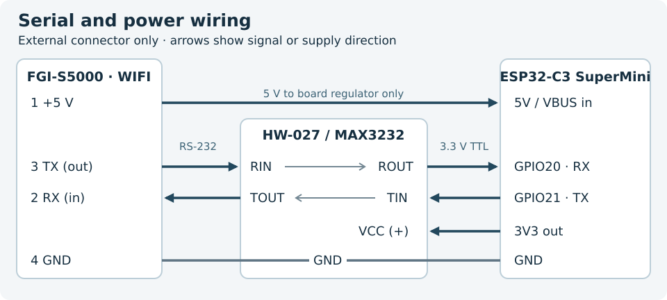
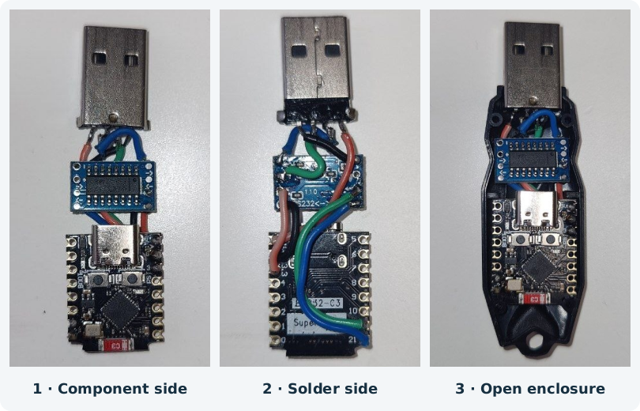

# Anern FGI-S5000: колектор RS-232 для Home Assistant

[English](README.md) · [Усі приклади](../README.uk.md)

У цієї версії FGI-S5000 (24 В, однофазний 5KU) не було заводського Wi-Fi-логера. До зовнішнього гнізда **WIFI** ми підключили ESP32-C3 SuperMini на 4 МБ через HW-027/MAX3232. EyeBond Local автоматично визначив інвертор, отримав показання та зміг змінювати налаштування. ESP передає дані послідовного порту; карта регістрів міститься в інтеграції HA, а не в прошивці колектора.

## 1. Знайдіть гніздо та перевірте контакти

[Оригінальне фото панелі](images/inverter-port.jpg). Дивимося **у гніздо інвертора**: напис WIFI читається прямо, BMS праворуч. Форма роз’єму — Type-A, але дані передаються через **RS-232, не USB**. В інструкції це COM-порт для зовнішнього логера; наведена поруч таблиця контактів стосується **BMS**, а не WIFI. Не під’єднуйте до WIFI комп’ютер чи звичайний USB-пристрій.

| Зліва направо, як на фото | Призначення з боку інвертора | Замір без колектора, відносно контакту 4 |
|---|---|---|
| 1 | Вихід живлення +5 В | +5,1 В |
| 2 | RX: приймає від колектора | Близько 0 В без передавача |
| 3 | TX: передає до колектора | Близько −5,6 В у стані спокою |
| 4 | Спільний сигнальний провід (GND) | Точка відліку |

Це виміри на конкретному екземплярі. З підключеним колектором обидві лінії можуть мати від’ємну напругу в стані спокою: на контакт 2 тепер подає сигнал перетворювач. Постійна напруга не підтверджує обмін даними. Перед подачею живлення продзвоніть контакти **від’єднаного штекера** до місць пайки: при погляді з іншого боку порядок може бути дзеркальним. Не покладайтеся на колір дроту; екран роз’єму не замінює контакт 4.

## 2. Зберіть колектор

Потрібні: ESP32-C3 SuperMini на 4 МБ з USB-C та інверсним світлодіодом GPIO8, модуль MAX3232 RS-232↔TTL з живленням від 3,3 В (на фото HW-027), чотириконтактний штекер Type-A, короткі ізольовані проводи та ізоляційний корпус. Відкривати інвертор не потрібно. Паяйте від’єднаний модуль; **виймайте штекер з інвертора**, перш ніж живити чи прошивати ESP через USB-C комп’ютера.

| Коло | Як з’єднано |
|---|---|
| Живлення | Контакт 1 → вхід **5V** ESP. Вихід **3V3** ESP → **+ / VCC** перетворювача. Не подавайте 5 В на 3V3 ESP або живлення логіки перетворювача. |
| Земля | Контакт 4 → GND ESP та **− / GND** перетворювача. |
| Від інвертора | Контакт 3 (TX) → RS-232 **RIN** → TTL **ROUT** → **GPIO20 (RX)** ESP. |
| До інвертора | **GPIO21 (TX)** ESP → TTL **TIN** → RS-232 **TOUT** → контакт 2 (RX). |

RIN/ROUT та TIN/TOUT позначають напрямок проходження сигналу; таких написів може не бути на платі. Якщо нанесено лише стрілки, спочатку визначте сторони RS-232 і TTL, далі — вхід та вихід **відносно самого перетворювача**. Не подавайте від’ємну напругу RS-232 прямо на GPIO. Керування RS485 DE/RE та зовнішній світлодіод не потрібні.

Фото повного розміру: [1 · Компоненти](images/collector-front.jpg) · [2 · Пайка та GPIO20/21](images/collector-back.jpg) · [3 · Корпус](images/collector-case.jpg).

## 3. Прошийте й налаштуйте

1. Оберіть [**esp32-c3.yaml**](../../../examples/esp32-c3.yaml). Це відкритий конфіг для плати та розведення з цього прикладу; у ньому немає даних Wi-Fi, адреси стенда чи фіксованого PN. Образ класичного ESP32 DevKit не підходить.
2. Від’єднайте штекер від інвертора. Підключіть USB-C плати кабелем **з лініями даних**. У випуску, де вже є **ESP32-C3 SuperMini (4 MB)**, оберіть його в [інсталяторі](https://groove-max.github.io/esp-eybond-collector/) або запишіть збірний файл `esp32-c3.factory.bin` через USB зі зміщенням 0. Для локальної збірки див. [інструкцію](../../RELEASING.md). Файл factory **не для OTA**.
3. Приєднайтеся до точки налаштування колектора (зазвичай назва — його PN на V), відкрийте `http://192.168.4.1/` та оберіть свою мережу 2,4 ГГц. Використовуйте довірену мережу; не відкривайте вебінтерфейс чи OTA в інтернет. Для власної збірки Dashboard імпортує той самий YAML для C3; див. [посібник](../../FLASHING.uk.md).
4. Від’єднайте USB-C та вставте колектор у **WIFI**. Параметри: **9600 бод, 8 біт даних, без парності, 1 стоп-біт**. Інвертор використовує **Modbus RTU, адреса 1**. Логи ESP передаються через USB окремо від UART інвертора.
5. У [EyeBond Local](https://github.com/groove-max/ha-eybond-local) використайте збірку з картою `fgi_5ku`, додайте колектор і залиште вибір інвертора **Auto**. Між різними підмережами широкомовний пошук може не працювати. Вкажіть на сторінці колектора доступну йому адресу HA і налаштований TCP-порт: з’єднання ініціює **ESP**. Краще скористатися приватним маршрутом/VPN. Поява колектора в HA сама по собі не підтверджує обмін з інвертором.

## 4. Звірте показання

На стенді з живленням від мережі HA визначив сімейство 5KU без ручного вибору карти й показав **232,8 В, 49,99 Гц і 0 Вт** без навантаження. Звірте свіже значення напруги з дисплеєм. Якщо колектор онлайн, але інвертор не знайдено, спочатку перевірте профіль плати, формат UART, живлення MAX3232 та напрямок обох сигнальних ліній. Якщо немає й самого колектора, почніть із Wi-Fi та адреси HA.

Відповіли всі 20 блоків штатного опитування. Із 74 елементів керування для 43 окремим читанням підтверджено зміну та повернення значення; 31 описано в карті, але так не перевірено. Батареї, PV та навантаження на стенді не було — тест не підтверджує заряджання, експорт або дію кожного параметра. Перевірку виконано зі збіркою HA, яка вже містила карту FGI. Якщо у вашій інтеграції цієї карти немає, сама заміна прошивки колектора її не додасть.
